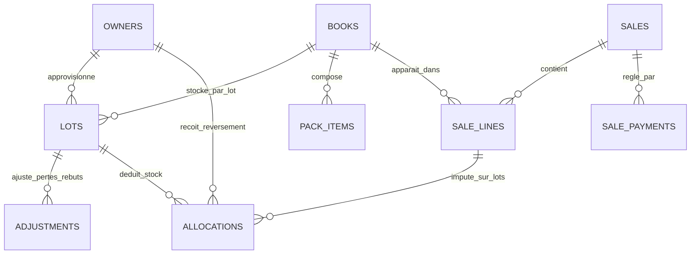

# Référentiel Schéma & Modèle de Données (Data Dictionary)

Ce document sert de schéma de référence (`information_schema` / dictionnaire des données) pour la base SQLite `data/librairie.db` et l'application Librairi-E. Il est maintenu à jour à chaque évolution structurelle.

---

## 1. Vue d'Ensemble des Tables



---

## 2. Dictionnaire Détaillé des Tables

### `owners` (Propriétaires & Origines de Stock)
Définit les entités propriétaires du stock (dépôt-vente ou acquisition locale).
| Colonne | Type | Description |
| :--- | :--- | :--- |
| `id` | INTEGER PRIMARY KEY | Identifiant unique (1: Cité Royale, 2: ICC Rennes...) |
| `name` | TEXT UNIQUE NOT NULL | Nom de l'origine (ex: `Cité Royale`, `ICC Rennes`) |
| `kind` | TEXT NOT NULL | `maison_mere` (dépôt) ou `locale` (fonds propre église) |
| `reverse_pct` | REAL DEFAULT 100 | % du prix de vente reversé à l'origine (ex: 100% pour Cité Royale) |
| `priority` | INTEGER DEFAULT 1 | Priorité d'écoulement du stock (1 = vendu en premier) |
| `color` | TEXT | Code couleur hexadécimal pour l'affichage UI |

---

### `books` (Catalogue & Articles)
Catalogue général des livres et des packs/lots promotionnels.
| Colonne | Type | Description |
| :--- | :--- | :--- |
| `id` | INTEGER PRIMARY KEY | Identifiant unique de l'article |
| `code` | TEXT UNIQUE NOT NULL | Code-barres ISBN / EAN ou référence interne |
| `title` | TEXT NOT NULL | Titre de l'ouvrage ou du pack |
| `series` | TEXT | Série / Collection |
| `volume` | TEXT | Numéro de tome / volume |
| `author` | TEXT | Nom de l'auteur |
| `publisher` | TEXT | Maison d'édition |
| `category` | TEXT DEFAULT 'Standard'| Catégorie thématique |
| `type` | TEXT | Format / Reliure (Broché, Relié, etc.) |
| `location` | TEXT | Emplacement en rayon / réserve |
| `price` | REAL DEFAULT 0 | Prix de vente TTC conseillé / public |
| `min_stock` | INTEGER DEFAULT 2 | Seuil d'alerte réapprovisionnement |
| `is_pack` | INTEGER DEFAULT 0 | `1` si c'est un pack/bundle virtuel, `0` si livre unitaire |
| `active` | INTEGER DEFAULT 1 | `1` actif, `0` archivé / masqué |

---

### `pack_items` (Composition des Packs)
Table de liaison décomposant chaque pack en ses livres unitaires constitutifs.
| Colonne | Type | Description |
| :--- | :--- | :--- |
| `pack_id` | INTEGER NOT NULL | Clé étrangère $\rightarrow$ `books.id` (le pack) |
| `book_id` | INTEGER NOT NULL | Clé étrangère $\rightarrow$ `books.id` (le livre composant) |
| `qty` | INTEGER DEFAULT 1 | Quantité de ce livre contenue dans le pack |
| *PK* | `(pack_id, book_id)` | Clé primaire composite |

---

### `lots` (Entrées de Stock & Réceptions)
Chaque livraison ou carton reçu est tracé sous forme d'un lot d'entrée daté rattaché à son propriétaire.
| Colonne | Type | Description |
| :--- | :--- | :--- |
| `id` | INTEGER PRIMARY KEY | Identifiant unique du lot |
| `book_id` | INTEGER NOT NULL | Clé étrangère $\rightarrow$ `books.id` |
| `owner_id` | INTEGER NOT NULL | Clé étrangère $\rightarrow$ `owners.id` (propriétaire du lot) |
| `date` | TEXT NOT NULL | Date de réception (ISO `YYYY-MM-DD`) |
| `qty_in` | INTEGER NOT NULL | Quantité initiale entrée en stock |
| `unit_cost` | REAL | Prix de revient unitaire (facultatif) |
| `reverse_pct` | REAL | Taux de reversement contractuel sur ce lot |
| `note` | TEXT | Référence bon de livraison ou carton |

*Formule du stock restant d'un lot :*  
$$\text{remaining} = \text{qty\_in} + \sum \Delta_{\text{adjustments}} - \sum \text{qty}_{\text{allocations}}$$

---

### `adjustments` (Ajustements de Stock & Rebuts)
Traces de pertes, dégradations, vols ou régularisations d'inventaire sur un lot.
| Colonne | Type | Description |
| :--- | :--- | :--- |
| `id` | INTEGER PRIMARY KEY | Identifiant unique |
| `lot_id` | INTEGER NOT NULL | Clé étrangère $\rightarrow$ `lots.id` |
| `date` | TEXT NOT NULL | Date de l'ajustement |
| `delta` | INTEGER NOT NULL | Variation négative (perte) ou positive (retrouvé) |
| `reason` | TEXT | Motif (Vol, Abîmé, Inventaire, etc.) |

---

### `sales` (En-tête des Ventes)
Représente un ticket de caisse / transaction client.
| Colonne | Type | Description |
| :--- | :--- | :--- |
| `id` | INTEGER PRIMARY KEY | Numéro unique de vente / ticket |
| `date` | TEXT NOT NULL | Date de vente (ISO `YYYY-MM-DD`) |
| `payment` | TEXT DEFAULT 'Espèces' | Mode de paiement principal ou résumé multi-mode |
| `user_name` | TEXT DEFAULT 'Anonyme'| Libraire ayant réalisé la vente |
| `customer_gender`| TEXT | Profil genre : `'Femme'`, `'Homme'`, `'Couple'` |
| `customer_age_group`| TEXT | Tranche d'âge : `'Enfant / Ado'`, `'Jeune adulte'`, `'Adulte'`, `'Senior'` |
| `is_star` | INTEGER DEFAULT 0 | `1` si le client/foyer est serviteur STAR, sinon `0` |
| `service_moment` | TEXT | Temps de culte : `'1er Culte'`, `'2e Culte'`, `'Culte Unique'`... |
| `note` | TEXT | Remarque libre ou mention d'origine (ex: `'Import Excel'`) |

---

### `sale_payments` (Multi-Paiements / Fractionnement)
Détail exact des encaissements lorsque le client combine plusieurs modes de règlement.
| Colonne | Type | Description |
| :--- | :--- | :--- |
| `id` | INTEGER PRIMARY KEY | Identifiant unique |
| `sale_id` | INTEGER NOT NULL | Clé étrangère $\rightarrow$ `sales.id` (`ON DELETE CASCADE`) |
| `payment` | TEXT NOT NULL | Moyen de paiement partiel (`CB`, `Espèces`, `Wero`...) |
| `amount` | REAL NOT NULL | Montant imputé sur ce moyen de paiement |

---

### `sale_lines` (Lignes d'Articles Vendus)
Articles composant le ticket de vente.
| Colonne | Type | Description |
| :--- | :--- | :--- |
| `id` | INTEGER PRIMARY KEY | Identifiant de la ligne |
| `sale_id` | INTEGER NOT NULL | Clé étrangère $\rightarrow$ `sales.id` (`ON DELETE CASCADE`) |
| `book_id` | INTEGER NOT NULL | Clé étrangère $\rightarrow$ `books.id` |
| `qty` | INTEGER NOT NULL | Nombre d'exemplaires vendus |
| `unit_price` | REAL NOT NULL | Prix unitaire facturé lors de la vente |

---

### `allocations` (Imputation Précise sur les Lots & Reversements)
Table maîtresse assurant la réconciliation financière et la déduction physique du stock.
| Colonne | Type | Description |
| :--- | :--- | :--- |
| `id` | INTEGER PRIMARY KEY | Identifiant unique de l'allocation |
| `line_id` | INTEGER NOT NULL | Clé étrangère $\rightarrow$ `sale_lines.id` (`ON DELETE CASCADE`) |
| `book_id` | INTEGER NOT NULL | Livre concerné |
| `lot_id` | INTEGER | Lot source dont l'exemplaire a été extrait |
| `owner_id` | INTEGER | Propriétaire du lot déduit |
| `qty` | INTEGER NOT NULL | Quantité déduite sur ce lot |
| `revenue` | REAL NOT NULL | CA généré par cette part ($= \text{qty} \times \text{prix unitaire}$) |
| `due` | REAL DEFAULT 0 | Montant dû à l'origine (reversé à la maison mère ou acquis) |
| `date` | TEXT NOT NULL | Date de l'opération |

---

### `audit_logs` (Traçabilité & Historique Undo)
Journal immuable de toutes les mutations pour audit et retour arrière.
| Colonne | Type | Description |
| :--- | :--- | :--- |
| `id` | INTEGER PRIMARY KEY | Numéro de log séquentiel |
| `timestamp` | TEXT NOT NULL | Horodatage complet ISO |
| `user_name` | TEXT NOT NULL | Utilisateur responsable de l'action |
| `action` | TEXT NOT NULL | `INSERT`, `UPDATE`, `DELETE`, `SALE`, `SPLIT_SALE`... |
| `target_type` | TEXT NOT NULL | `book`, `lot`, `sale`, `adjustment`, `option`... |
| `target_id` | INTEGER | ID de l'entité ciblée |
| `summary` | TEXT NOT NULL | Description humaine de l'opération |
| `snapshot_before` | TEXT (JSON) | État JSON avant modification |
| `snapshot_after` | TEXT (JSON) | État JSON après modification |
| `undone` | INTEGER DEFAULT 0 | `1` si annulé via Undo, `0` sinon |
| `undone_at` | TEXT | Horodatage de l'annulation |
| `undone_by` | TEXT | Utilisateur ayant annulé |

---

## 3. Index de Performance & Contraintes

```sql
CREATE INDEX IF NOT EXISTS ix_alloc_date ON allocations(date);
CREATE INDEX IF NOT EXISTS ix_alloc_book ON allocations(book_id);
CREATE INDEX IF NOT EXISTS ix_lots_book ON lots(book_id);
CREATE INDEX IF NOT EXISTS ix_audit_timestamp ON audit_logs(timestamp);
CREATE INDEX IF NOT EXISTS ix_sale_payments_sale ON sale_payments(sale_id);
```

---

## 4. Règles Métier Fondamentales (Invariants)

1. **Intégrité Stock / Lot** : Aucune vente ne peut exister sans allocation sur un lot existant.
2. **Scission de vente** : Scinder une vente réattribue les `sale_lines` et leurs `allocations` exactes sans jamais modifier le stock disponible en rayon.
3. **Cas Cité Royale vs ICC Rennes** :
   - Cité Royale (maison mère) : `reverse_pct = 100%`, montant total dû reversé.
   - ICC Rennes (église locale) : `reverse_pct = 0%`, marge 100% conservée localement.

### `app_settings` (Réglages applicatifs)

```sql
CREATE TABLE IF NOT EXISTS app_settings(
  key TEXT PRIMARY KEY,
  value TEXT NOT NULL);
```

Clés connues : `local_card_enabled` (`0`/`1`, CB du stock local — désactivée par défaut), `service_moment`/options déroulantes pilotées via `/api/options`. Accès : `db.get_setting(c, key, default)` / écriture via les routers.

## 5. Versionnement & migrations

La version du schéma est stockée dans `PRAGMA user_version`. Toute évolution de schéma doit incrémenter `LATEST_SCHEMA_VERSION` dans `app/db.py` et ajouter la migration correspondante dans `SCHEMA_MIGRATIONS` :

- **v2** : ajout du réglage `local_card_enabled` (`INSERT OR IGNORE` dans `app_settings`).

Avant migration d'une base existante, une copie vérifiée est créée sous `data\sauvegardes\librairie_pre_migration_*.db`.
